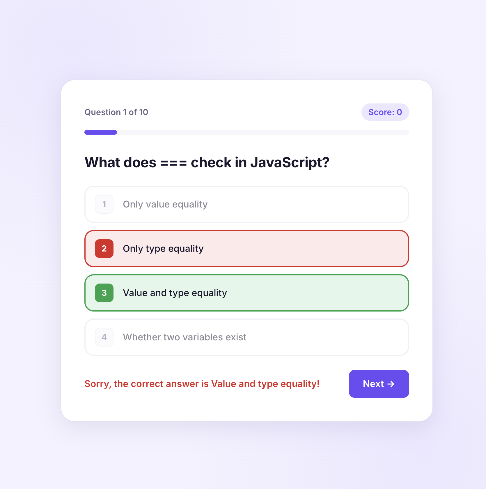

# QuizMaster

This is a quiz for the basics of web development.

**Live demo:** https://alexuscarter.github.io/quizmaster/

## Features

- 10 questions in a new random order every game
- Instant feedback: your answer turns green or red, and the correct answer is always shown
- Live score and progress bar
- Results screen with a score ring, a message based on your score, and a review of every question you missed
- Best score saved in the browser with `localStorage`, so it survives a page reload
- Keyboard controls: keys `1`–`4` to answer, `Enter` for the next question

## Built with

- HTML, CSS and vanilla JavaScript (no frameworks or libraries)
- The UI design, HTML and CSS were provided as a starter; I wrote all of the JavaScript.

## What I learned

- **Building the page from data:** each question's answer buttons are created from an array of objects with `createElement`, instead of being written in the HTML.
- **Keeping state in variables and redrawing from it:** `currentQuestion`, `score` and `wrongAnswers` decide what's on screen, and `showQuestion()` redraws it. This is the same idea React is built on.
- **`textContent` vs `innerHTML`:** answers like `<a>` would disappear with `innerHTML`, because the browser reads them as real tags.
- **The Fisher–Yates shuffle,** and why I shuffle a copy (`[...array]`) so the original questions stay untouched.
- **Closures in event listeners:** each button's `() => checkAnswer(index)` remembers its own index.
- **Saving data with `localStorage`,** and converting it back with `Number()` because it only stores text.

## What I'd improve next

Shuffle the four answers too, not just the questions

- Add a timer for each question
- Let players choose a category (HTML, CSS or JavaScript)
